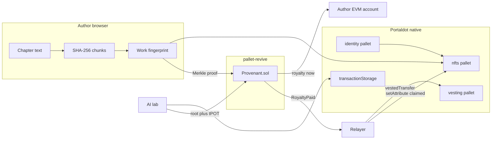
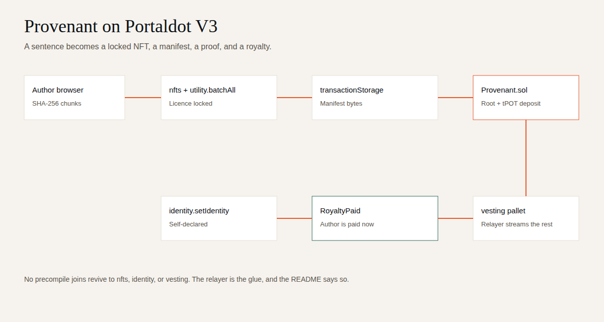

# Provenant

**Turn the AI copyright war into a market.**

Authors register a work. An AI lab publishes the training manifest and escrows a deposit. The author proves their work is in that manifest. The contract pays the royalty.

Portaldot is the only place this is one system: native NFTs for the work, native identity for the person, `transactionStorage` for the manifest, pallet-revive for the proof and the escrow, and the vesting pallet for the royalty that should arrive over time.

## The problem, in money

Training-data licensing is already a market, and the lawsuits are the invoices nobody agreed to.

- **$1.5 billion.** Anthropic’s 2025 copyright settlement, reported by the [Associated Press](https://apnews.com/article/anthropic-authors-copyright-judge-artificial-intelligence-9643064e847a5e88ef6ee8b620b3a44c), covering roughly 482,000 books.
- **About $4.8 billion in 2025, toward about $22 billion by 2034.** Dataset licensing for AI training, as estimated by [Marketintelo](https://marketintelo.com/report/dataset-licensing-for-ai-training-market) and [Dataintelo](https://dataintelo.com/report/dataset-licensing-for-ai-training-market). Those are publisher estimates, not an audit.
- The EU AI Act asks general-purpose model providers for a summary of training data. A manifest that was never committed cannot be summarised after the fact. [TechCrunch on RSL](https://techcrunch.com/2025/09/10/rss-co-creator-launches-new-protocol-for-ai-data-licensing/) put the same point simply: if training is not logged when it happens, proving a document was ingested becomes close to impossible.

Provenant does not claim to see hidden scrapes. It makes a *declared* training set checkable, and it makes an undeclared one a lie with a date on it. A licence is cheaper than the next settlement. The later step, not in this build, is a TEE-attested training run that can say the declared set is the one that was actually loaded.

## Why only Portaldot

Remove Portaldot and the clearing house splits into a database, an L2 escrow, and a hope that someone stored the file.

| Step | Native call | What fails elsewhere |
|---|---|---|
| Register the work | `nfts.mint`, `nfts.setAttribute`, `nfts.lockItemProperties` inside `utility.batchAll` | An ERC-721 on revive would be a different object from a native NFT. The guide is explicit: no adapter unless Portaldot ships one. |
| Say who the author is | `identity.setIdentity` | Self-declared. `identity.registrars()` is empty on the V3 testnet (read 22 Oct 2026). A registrar is root-only. The NFT attribute `identity = self-declared` says so on the item. |
| Publish the manifest | `transactionStorage.store` (fallback `preimage.notePreimage` or `system.remarkWithEvent`) | The bytes have to live somewhere the proof can point at. Transaction storage is that data-availability pallet, cap 8 MiB. |
| Prove inclusion and pay | `Provenant.claim` on pallet-revive | Solidity verifies the Merkle leaf and pays from the lab’s deposit. Chain id `420420777` is hard-coded off-chain. The contract does not read `block.chainid` or `block.timestamp`; those opcodes are reported to revert on revive, and the bytecode scanner shows this contract contains none of them. |
| Stream the long royalty | `vesting.vestedTransfer` from the relayer | There is no vesting precompile. The pallet minimum, read from `vesting.minVestedTransfer`, is **10 tPOT** (`1000000000000000` planck). The relayer hears `RoyaltyPaid` and submits the stream. |

`reviveApi.accountId` maps the MetaMask address to the native `5…` account that must be funded. One person, two addresses, one runtime.

## Architecture





The relayer exists because the guide’s FAQ says an ERC token, a native asset, and a native NFT stay separate objects until Portaldot ships an adapter. Solidity cannot call `nfts` or `vesting`. The relayer is the glue, and it writes every transaction hash to `evidence/` before it waits for inclusion. The EVM RPC prunes receipts.

## How a royalty clears

1. **Register.** The browser splits the chapter on blank lines and chains SHA-256 over the exact chunks (`provenant.work.v1`). The native batch mints a Work NFT and locks `fingerprint`, `licence = training-royalty-v1`, and `royaltyBps`.
2. **Publish.** The lab picks works. Each royalty is `deposit * bps / 10_000`, rounded down to a planck (10^4 wei, because 1 planck = 10^4 wei on revive). The leaf is `keccak256(abi.encodePacked(fingerprint, author, royalty))`. The tree is a sorted-pair keccak. The manifest bytes go to `transactionStorage`. The root and the deposit go to `registerDataset`.
3. **Claim.** The author pastes the same chapter. The app rebuilds the proof. `claim` pays that author from the deposit, or reverts. A chapter that was not in the tree cannot be paid. `close` returns whatever the lab did not owe.

The specimen in the app is the public-domain opening of *Pride and Prejudice* (1813), with Doyle in the sample manifest and Shelley held out.

## Scope of work

Built in this repository for Portaldot Hacker House 2026. Phases match the commit history.

| Phase | What landed |
|---|---|
| P0 | Monorepo, fingerprint and Merkle core, shared by the contract tests and the app |
| P1 | `Provenant.sol`, 1,532 bytes of runtime code, Hardhat tests, opcode probe that is not deployed |
| P2 | Native scripts: mint `batchAll`, `setIdentity`, manifest store, `vestedTransfer`, account mapping |
| P3 | Relayer: persist `RoyaltyPaid` immediately, then vesting when `SURI` is set |
| P4 | Next.js app: landing, register, publish, inclusion check, registry |
| P5 | `evidence/`, `verify`, local Hardhat end-to-end |

Track: Ecosystem DApps, with a middleware shape (the manifest and the proof are what a lab would call). Grand-prize pitch is the market, not the form.

## Run it

```bash
npm install
npm test                 # core, Hardhat, native id test
npm run e2e:local        # Hardhat node, deploy, two claims, held-out revert, verify
npm run dev              # http://localhost:3000
npm run probe            # read-only testnet metadata, writes evidence/testnet-readonly.json
npm run verify           # offline checks plus the live testnet reads
```

The web app has three modes.

- **Workshop.** No contract address. The registry stays in this browser. Claims are labelled as local and move no tPOT.
- **Local Hardhat.** `npm run e2e:local` writes `web/.env.local`. The demo signer in `/api/evm` broadcasts only to `127.0.0.1` or `localhost`, using the public Hardhat keys. It refuses those keys against any other RPC.
- **Portaldot.** Set the variables below. MetaMask sends `registerDataset` and `claim`. Native minting is the CLI, or the relayer’s prepare endpoint, which encodes against live metadata and does not submit unless you pass `--submit` with `SURI` set.

## Deploy on the V3 testnet

You need tPOT. There is no self-serve faucet. Register on DoraHacks with your native `5…` address and ask in Discord. A practical first balance is **300–500 tPOT**:

| Use | Amount, from constants read on 22 Oct 2026 |
|---|---|
| Contract code deposit | 1,532 bytes. Other teams report about 0.06–0.095 tPOT per byte, so **about 92–146 tPOT**. This repo has not paid that deposit; the rate is not a constant we could read. |
| First Work NFT | `collectionDeposit` **1 tPOT**, `itemDeposit` **0.1**, `attributeDepositBase` **0.1**. Eight attributes are on the order of **2 tPOT** before any per-byte surcharge, plus a `paymentInfo` fee around **0.056 tPOT** for the batch. |
| Manifest | `transactionStorage.store` fee depends on the blob. The sample manifest encoded at about 0.08 tPOT of fee. |
| Royalty escrow | Whatever the lab passes to `registerDataset`. The sample uses 1 tPOT. |
| Vesting stream | Minimum **10 tPOT**, read from `vesting.minVestedTransfer`. |

1. Copy `.env.example` to `.env`. Set `PRIVATE_KEY` (EVM) and `SURI` (sr25519). Never put them in the shell history of a shared machine if you can avoid it, and never commit `.env`.
2. Map the deployer: `npm run native -- map --evm 0xYOUR_METAMASK_ADDRESS`. Fund **that** `5…` account with `balances.transferKeepAlive`. Do not send native POT straight at the `0x` address.
3. `npm run deploy:evm`. The script prints the address, the transaction hash, and the byte-size estimate, and appends the hash to `evidence/submitted-hashes.jsonl` as soon as it exists. Copy both into `evidence/testnet.json`. The EVM RPC drops old receipts.
4. Mint a work: `npm run native -- mint --title "…" --author-name "…" --owner 5… --text-file chapter.txt --submit`.
5. Build a manifest JSON (`version`, `licence`, `model`, `lab`, `works`, `root`) and `npm run native -- manifest --file manifest.json --submit`.
6. Put `PROVENANT_ADDRESS` and `NEXT_PUBLIC_PROVENANT_ADDRESS` in the environment. Point `NEXT_PUBLIC_EVM_RPC` at `https://test-evm-rpc-v3.portaldot.dev`.
7. In the app, add the chain in MetaMask (button on the connect flow, chain id `420420777`, symbol `tPOTv3`, 18 decimals on the EVM side; native decimals are 14). Publish the dataset, then claim.
8. `npm run relayer` with `SURI` set to the lab’s native key and `PROVENANT_ADDRESS` set. It polls `eth_getLogs`, appends `evidence/relayer-events.jsonl` immediately, and submits `vestedTransfer` of 10 tPOT over 10,000 blocks when the signer is funded. Bind stays on `127.0.0.1`.

`npm run verify` re-reads the testnet and, with `--local` while a Hardhat node is still up, re-reads the local deployment. It prints `N/N checks passed`.

Vercel or Render: deploy the `web` workspace (`npm run build -w web`). Set the `NEXT_PUBLIC_*` variables. The relayer and the native CLI are Node processes, not part of the static app. Workshop mode works with no variables at all.

Explorer for native extrinsics: [node-console.portaldot.dev](https://node-console.portaldot.dev/#/explorer). There is no EVM block explorer. EVM proof is the transaction hash plus `eth_getTransactionByHash`.

## Evidence

`evidence/testnet-readonly.json` is a read-only probe of `wss://test-node-v3.portaldot.dev` and the EVM RPC: spec `portaldot-v3` v3002, ss58 42, 14 decimals, chain id 420420777, the six pallets above, empty registrars, and successful encodings of the four native calls. No extrinsic was submitted.

`evidence/local-e2e.json` is the transcript of the Hardhat stand-in after `npm run e2e:local`. Those hashes die with the node. Re-run the script to reproduce them.

## What’s mocked

- **No testnet deployment yet.** The deployer key and tPOT are not in this environment. Scripts are ready; the chain is not funded.
- **Exact chunks only.** No MinHash or simhash. A changed comma is a different work.
- **Identity is self-declared.** Confirmed: `registrars` is `[]`.
- **No model is trained.** `portaldot-demo-lora` is a name on a manifest, not a fine-tune.
- **Vesting has not moved tPOT.** The call encodes against the live runtime. Submission waits on `SURI` and 10 tPOT.
- **Workshop claims do not move money.** The UI says so.
- **Hardhat is not pallet-revive.** `block.timestamp` works on Hardhat and is reported to revert on revive. `Provenant.sol` does not use it. `OpcodeProbe.sol` does, and it is not in the deploy script.
- **The relayer is off-chain glue.** Disclosed above. A precompile would delete it.
- **No in-browser Polkadot extension.** Native calls are encoded by the CLI or `POST /api/native/prepare`. Submission is `npm run native -- … --submit` with `SURI`. MetaMask is the EVM wallet.

## Contract notes

`contracts/contracts/Provenant.sol`. Solidity 0.8.24, optimizer runs 1, Shanghai, via IR, metadata stripped. Runtime code **1,532 bytes**. Custom errors. Checks, then effects, then the value transfer. The leaf binds the caller and the amount, so a proof cannot be redirected or inflated. Amounts must be multiples of 10,000 wei.

## Layout

| Path | Role |
|---|---|
| `packages/core` | Fingerprints, leaves, proofs, sample corpus |
| `contracts` | Provenant, Hardhat tests, deploy and local e2e |
| `native` | `@polkadot/api` scripts |
| `relayer` | Event cursor and vesting |
| `web` | Next.js app |
| `verify/verify.ts` | The N/N checker |
| `evidence` | Probe output and local transcript |

## Licence

MIT. Instrument Serif and Inter Tight are under the SIL Open Font License; see `web/public/fonts/`. The build does not fetch fonts.
